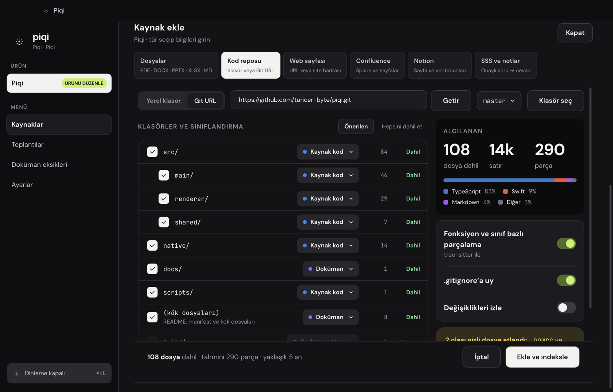
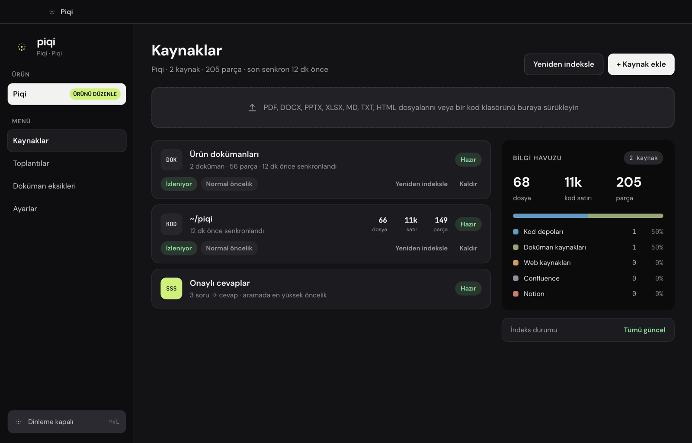
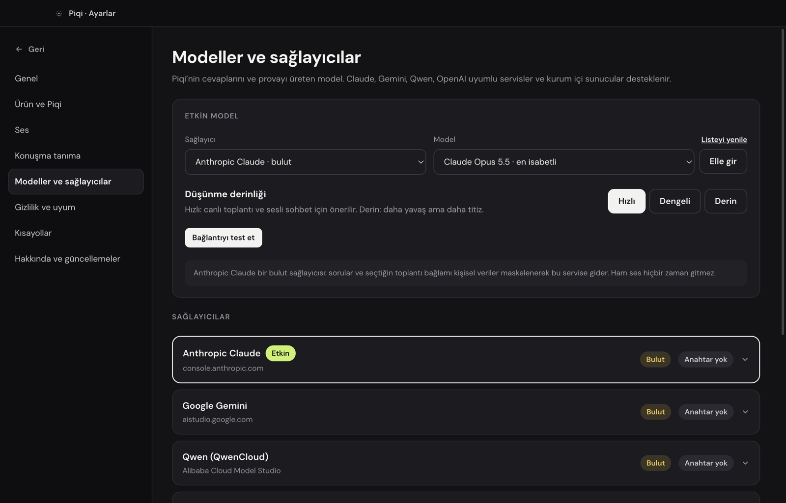
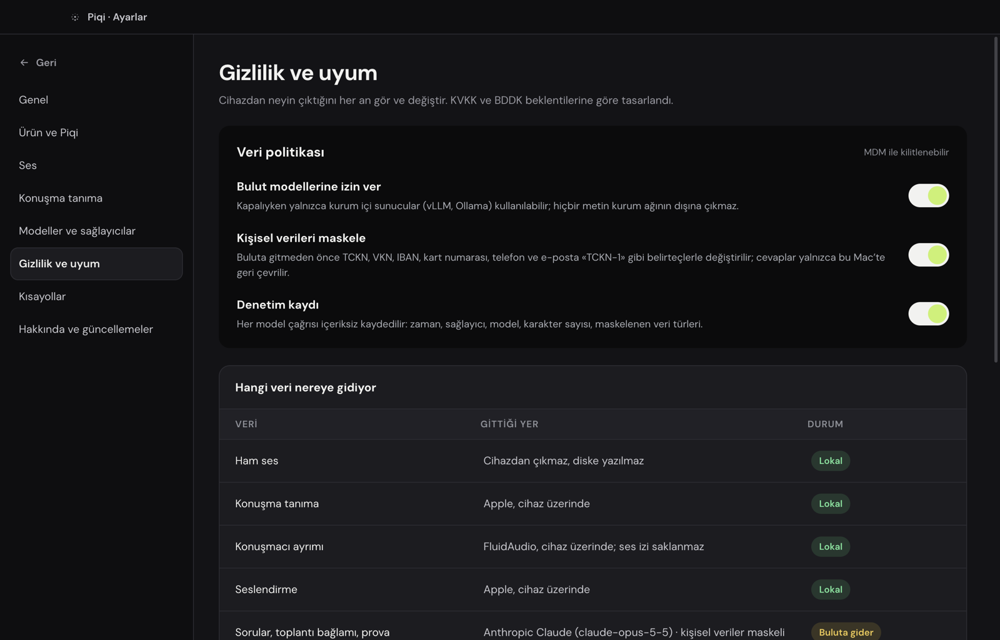

<div align="center">
  
  <h1>Piqi</h1>
  <p><strong>Meeting answers, grounded in your product knowledge.</strong></p>
  <p>A macOS meeting assistant with live transcription, a searchable knowledge base, and source-linked answers.</p>
</div>

Piqi helps solution architects, pre-sales engineers, and technical consultants find reliable product and technical information while they are in a meeting. It listens to configured microphone and meeting audio, transcribes speech, searches the knowledge sources you have indexed, and presents concise answers with references in a compact on-screen Island.

Piqi is a desktop assistant, not a meeting bot. It does not join calls or speak to other participants on your behalf. You review its suggestions and respond in your own words.

> **Project status:** Piqi is under active development. The current app supports live transcription, source management, automatic answers to the other side's questions, and an approved-answer workflow. Persistent meeting history, automatic summaries, and signed packaged distribution are not complete yet.

<p align="center">
  
</p>
<p align="center"><sub>⌘⇧K: a question answered from the local knowledge base, with its source.</sub></p>

## What Piqi Does

- Detects Teams, Zoom, Webex, Slack, FaceTime, and browser calls, and starts listening when you join (or asks first).
- Captures microphone and supported meeting-app audio as separate channels.
- Shows a live transcript so you can follow what Piqi is hearing.
- Detects product questions from the other side of the meeting and, when your sources cover them, prepares a source-linked answer in the Island.
- Lets you invoke Piqi by voice or open a written or spoken ask panel.
- Searches indexed product documents, code, web pages, and connected knowledge sources.
- Presents concise answers with source references and expandable detail where available.
- Collects questions it could not answer from your sources, so you can write an approved answer once and have it reused instantly.
- Lets you configure one product profile with its name, sector, Piqi character, instructions, and recognition glossary.
- Provides controls for model providers, cloud access, personal-data masking, and audit logging.

## Add Knowledge Sources

Open **Sources**, select **Add source**, and choose a source type. You can add:

| Source type | What you can add |
|---|---|
| Documents | PDF, DOCX, PPTX, XLSX, Markdown, TXT, or HTML files and folders |
| Images | PNG, JPG, HEIC, WebP, GIF, TIFF, or BMP: screenshots, architecture diagrams, charts, photographed tables, scanned pages |
| Code repositories | A local folder or Git URL; review detected folders and choose what to include |
| Web | A public URL, optionally following a sitemap within a page limit |
| Confluence | A Cloud or Data Center / Server space |
| Notion | Pages accessible to a Notion integration |
| Approved Q&A | Curated question-and-answer pairs for stable product facts |

Images are read by the selected model: Piqi downsizes each image, then the model writes out its title, a short summary, all visible text (tables as Markdown), and the concrete details needed to answer questions, such as numbers, components and their connections, or chart values. That text is indexed like any other document, so answers can cite the image. An image is analyzed once and again only if the file changes. The file preview shows which model will be used before anything is sent.

For code repositories, Piqi scans the folder tree, observes `.gitignore` by default, and lets you choose folders and categories before indexing.

<p align="center">
  
</p>
<p align="center"><sub>Adding a code repository: review detected folders and categories, then index.</sub></p>

Local code and document sources can be configured for change watching. The Sources screen shows source status and available counts, including indexed files, code lines, and chunks. Use **Reindex** to refresh a source manually.

<p align="center">
  
</p>
<p align="center"><sub>The Sources screen with documents, a code repository, and approved answers indexed.</sub></p>

## Use Piqi in a Meeting

### 1. Add your sources

Add and index the documents, repositories, and other sources you want Piqi to consult, as described in [Add Knowledge Sources](#add-knowledge-sources).

### 2. Choose a model

Open **Settings → Models and providers** and select a model provider. Add the provider credential in the app, or configure a compatible local endpoint. **Thinking depth** trades speed for thoroughness; **Fast** is recommended during live meetings.

<p align="center">
  
</p>

### 3. Review privacy settings

Review **Settings → Privacy and compliance**. Choose whether cloud models are allowed and whether personal data should be masked before a request is sent. The table below the switches shows where each kind of data goes under the current policy.

<p align="center">
  
</p>

### 4. Grant permissions and join a call

Grant the macOS permissions needed for the capture options you enable, and configure microphone and system-audio capture in **Settings → Audio**.

Piqi detects calls automatically. When Microsoft Teams, Zoom, Webex, Slack, FaceTime, or a browser (for example, Google Meet) starts using the microphone, Piqi treats it as a call. Choose what happens in **Settings → Audio → Detect meetings automatically** (*Toplantıyı otomatik algıla*):

| Mode | Behavior |
|---|---|
| Ask (default) | The Island shows “Zoom call detected” with **Start listening** and **Not now**. |
| Automatic | Listening starts on its own. For browsers, Piqi still asks, because a browser can use the microphone for other things. |
| Off | Nothing happens; start listening yourself. |

When listening was started by detection, it stops by itself about 20 seconds after the app releases the microphone. If system audio is set to all apps, a detected call captures only that app's audio, so music and notifications stay out of the transcript. Detection reads macOS audio process state and does not need screen-recording permission or window titles.

You can always start or stop listening from the app, the menu bar, or **⌘⇧L**. The **Meetings** page shows the live transcript and, when enabled, the detected speakers.

### 5. Get answers

**Questions from the other side.** With **Settings → Speech recognition → Answer the other side's questions automatically** (*Karşı tarafın sorularını otomatik cevapla*) enabled and the other side's transcript turned on, Piqi checks each finished sentence from the meeting audio. Small talk and meeting logistics such as “Can you hear me?” are ignored. For a product question, Piqi searches your sources locally; if a source covers the question well, the question and a short, source-linked answer appear in the Island. If nothing in your sources covers it, Piqi does not call a model and records the question under **Document gaps** (*Doküman eksikleri*) instead.

Press **⌘⇧Space** to answer the other side's most recent question right away, for example when automatic answers are off or a question was skipped.

**Your own questions.** Say **“Selam Piqi”** to ask by voice, or press **⌘⇧K** to type a question, as shown at the top of this page.

### 6. Improve answers over time

- **Add to approved answers.** When an answer is right, select **Add to FAQ** (*SSS’ye ekle*) in the Island. The next time the same question comes up, Piqi shows that approved answer immediately, without a model call.
- **Document gaps.** Questions that had no matching source, were answered without a source, or received negative feedback are listed on the **Document gaps** page, with how often each was asked. Write an approved answer there to add it to your FAQ; the question then leaves the list.

The global **⌘⇧L** shortcut starts or stops listening. Other shortcuts are listed in **Settings → Shortcuts**. Shortcut registration may fail if another application already uses the same combination.

## Privacy and Data Handling

- Raw captured audio is processed as a live stream and is not saved as an audio recording.
- Speech recognition runs on the Mac with the current Apple speech-recognition integration. Audio capture depends on the macOS permissions and sources you configure.
- When a cloud model is selected and allowed, the text required for that model request is sent to the selected provider. Piqi does not send every indexed source or transcript automatically; requests are made for assistant tasks.
- The privacy settings can mask detected identifiers, including national or tax IDs, IBANs, card numbers, phone numbers, and email addresses, before text is sent to a cloud model. Review the effective policy before using sensitive material.
- Images added as sources are sent to the selected model for analysis when the source is indexed. Personal-data masking applies to text only and cannot be applied to image content; use an on-premises model or keep cloud models disabled for sensitive images.
- Provider API keys and remote-source credentials are stored in the macOS Keychain rather than in source records.
- Optional audit records contain request metadata, not question or answer text.
- Speaker separation does not retain voiceprints; speaker labels are temporary for the listening session.
- The meeting transcript is kept in memory only (the last 15 minutes) and is not written to disk. Document gaps store only the question text, who asked, and counts, in the app's local data folder.

These controls do not replace your organization’s privacy, security, or data-handling review. Confirm that you are authorized to connect a source and use the selected model provider with its contents.

## Supported Model Providers

Piqi includes adapters for Anthropic, Google Gemini, and OpenAI-compatible APIs. OpenAI-compatible endpoints can be used with hosted providers or local services such as Ollama and compatible self-hosted servers. Availability depends on provider credentials, endpoint configuration, and the active privacy policy.

## Requirements

- macOS 14.4 or later
- Node.js 23 or later
- Xcode with Swift 6.1 or later, for the native audio helper
- Rust toolchain for the local text-to-speech helper; its version is pinned in `native/piqi-tts/rust-toolchain.toml`

The development command builds the native helpers before starting Electron. Some native dependencies or speech models may need to be downloaded during the first build or first use.

## Run From Source

```sh
git clone https://github.com/tuncer-byte/piqi.git
cd piqi
npm install
npm run dev
```

On first launch, macOS may request microphone, speech-recognition, and system-audio permissions. Grant only the permissions needed for the capture features you intend to use. Then configure a model provider and add at least one knowledge source before trying source-grounded answers.

Useful development commands:

```sh
npm test          # Run the test suite
npm run typecheck # Type-check the Electron and renderer projects
npm run build     # Build native helpers and the Electron app
npm run dist      # Package a macOS app
```

## Project Layout

| Path | Purpose |
|---|---|
| `src/main` | Electron main process, audio services, assistant, settings, and knowledge indexing |
| `src/renderer` | Main application, settings, Sources and Meetings screens, and Island interface |
| `src/preload` | Typed bridge between the renderer and Electron main process |
| `src/shared` | Shared types, IPC contracts, provider definitions, and brand assets |
| `native/piqi-audio` | Swift helper for audio capture, transcription, and speaker processing |
| `native/piqi-tts` | Rust-based local text-to-speech helper |
| `resources` | Application resources, including the Piqi icon used above |
| `docs/PRD.md` | Product requirements and design context; some items describe future work |

## About the Screenshots

Screenshots and recordings were taken from the running app with a profile indexed with this repository's own documentation and code. The ⌘⇧K recording is a real answer from an approved Q&A entry in that profile.

## Contributing

Piqi is evolving quickly, and the product brief includes planned features that may not be present in the current app. When contributing, check the implementation and tests alongside the PRD, keep changes focused, and avoid treating roadmap items as shipped functionality.