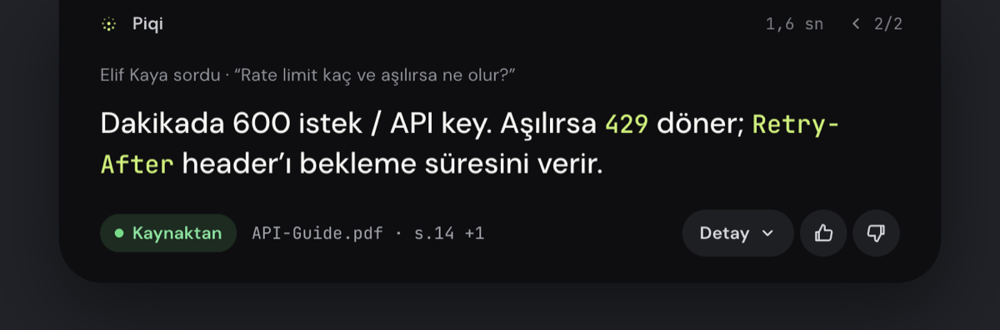
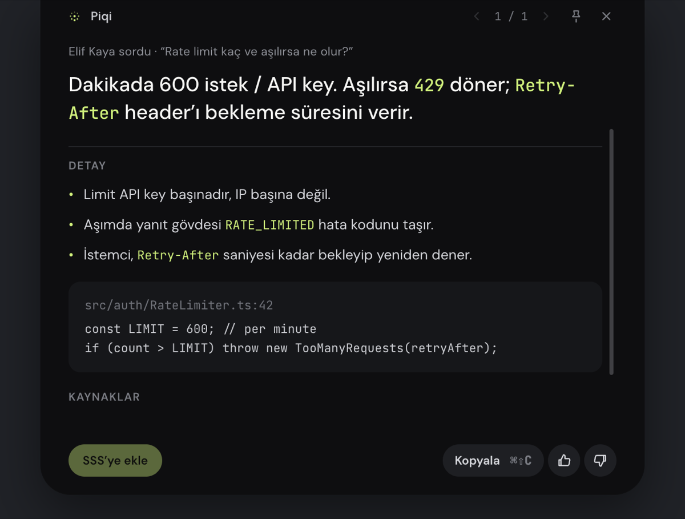

<div align="center">
  
  <h1>Piqi</h1>
  <p><strong>Meeting answers, grounded in your product knowledge.</strong></p>
  <p>A macOS meeting assistant with live transcription, a searchable knowledge base, and source-linked answers.</p>
</div>

Piqi helps solution architects, pre-sales engineers, and technical consultants find reliable product and technical information while they are in a meeting. It listens to configured microphone and meeting audio, transcribes speech, searches the knowledge sources you have indexed, and presents concise answers with references in a compact on-screen Island.

Piqi is a desktop assistant, not a meeting bot. It does not join calls or speak to other participants on your behalf. You review its suggestions and respond in your own words.

> **Project status:** Piqi is under active development. The current app supports live transcription, source management, and in-meeting assistance. Persistent meeting history, automatic summaries, and packaged distribution are not complete yet.

## Screenshots

<p align="center">
  
</p>
<p align="center"><em>The Island: a short answer with its source, shown at the top of the screen while the meeting continues.</em></p>

<p align="center">
  
</p>
<p align="center"><em>Expanded detail with supporting points and the relevant code excerpt.</em></p>

| Sources | Models and providers | Privacy and compliance |
|---|---|---|
|  |  |  |

Screenshots use a demo profile indexed with this repository's own documentation and code. The Island answer is the app's built-in demo content.

## What Piqi Does

- Captures microphone and supported meeting-app audio as separate channels.
- Shows a live transcript so you can follow what Piqi is hearing.
- Lets you invoke Piqi by voice or open a written or spoken ask panel.
- Searches indexed product documents, code, web pages, and connected knowledge sources.
- Presents concise answers with source references and expandable detail where available.
- Lets you configure one product profile with its name, sector, Piqi character, instructions, and recognition glossary.
- Provides controls for model providers, cloud access, personal-data masking, and audit logging.

## Add Knowledge Sources

Open **Sources**, select **Add source**, and choose a source type. You can add:

| Source type | What you can add |
|---|---|
| Documents | PDF, DOCX, PPTX, XLSX, Markdown, TXT, or HTML files and folders |
| Code repositories | A local folder or Git URL; review detected folders and choose what to include |
| Web | A public URL, optionally following a sitemap within a page limit |
| Confluence | A Cloud or Data Center / Server space |
| Notion | Pages accessible to a Notion integration |
| Approved Q&A | Curated question-and-answer pairs for stable product facts |

For code repositories, Piqi scans the folder tree, observes `.gitignore` by default, and lets you choose folders and categories before indexing. Local code and document sources can be configured for change watching. The Sources screen shows source status and available counts, including indexed files, code lines, and chunks. Use **Reindex** to refresh a source manually.

## Use Piqi in a Meeting

1. Add and index the documents, repositories, and other sources you want Piqi to consult.
2. Open **Settings → Models and providers** and select a model provider. Add the provider credential in the app, or configure a compatible local endpoint.
3. Review **Settings → Privacy and compliance**. Choose whether cloud models are allowed and whether personal data should be masked before a request is sent.
4. Grant the macOS permissions needed for the capture options you enable. Configure microphone and system-audio capture in **Settings → Audio**.
5. Start listening from the app or menu bar. The **Meetings** page shows the live transcript and, when enabled, the detected speakers.
6. Say **“Selam Piqi”** to ask by voice, or press **⌘⇧K** to open the ask panel. Review the answer and its source references in the Island.

The global **⌘⇧L** shortcut starts or stops listening. Other shortcuts are listed in **Settings → Shortcuts**. Shortcut registration may fail if another application already uses the same combination.

## Privacy and Data Handling

- Raw captured audio is processed as a live stream and is not saved as an audio recording.
- Speech recognition runs on the Mac with the current Apple speech-recognition integration. Audio capture depends on the macOS permissions and sources you configure.
- When a cloud model is selected and allowed, the text required for that model request is sent to the selected provider. Piqi does not send every indexed source or transcript automatically; requests are made for assistant tasks.
- The privacy settings can mask detected identifiers, including national or tax IDs, IBANs, card numbers, phone numbers, and email addresses, before text is sent to a cloud model. Review the effective policy before using sensitive material.
- Provider API keys and remote-source credentials are stored in the macOS Keychain rather than in source records.
- Optional audit records contain request metadata, not question or answer text.
- Speaker separation does not retain voiceprints; speaker labels are temporary for the listening session.

These controls do not replace your organization’s privacy, security, or data-handling review. Confirm that you are authorized to connect a source and use the selected model provider with its contents.

## Supported Model Providers

Piqi includes adapters for Anthropic, Google Gemini, and OpenAI-compatible APIs. OpenAI-compatible endpoints can be used with hosted providers or local services such as Ollama and compatible self-hosted servers. Availability depends on provider credentials, endpoint configuration, and the active privacy policy.

## Requirements

- macOS 14.4 or later
- Node.js 23 or later
- Xcode with Swift 6.1 or later, for the native audio helper
- Rust toolchain for the local text-to-speech helper; its version is pinned in `native/piqi-tts/rust-toolchain.toml`

The development command builds the native helpers before starting Electron. Some native dependencies or speech models may need to be downloaded during the first build or first use.

## Run From Source

```sh
git clone https://github.com/tuncer-byte/piqi.git
cd piqi
npm install
npm run dev
```

On first launch, macOS may request microphone, speech-recognition, and system-audio permissions. Grant only the permissions needed for the capture features you intend to use. Then configure a model provider and add at least one knowledge source before trying source-grounded answers.

Useful development commands:

```sh
npm test          # Run the test suite
npm run typecheck # Type-check the Electron and renderer projects
npm run build     # Build native helpers and the Electron app
npm run dist      # Package a macOS app
```

## Project Layout

| Path | Purpose |
|---|---|
| `src/main` | Electron main process, audio services, assistant, settings, and knowledge indexing |
| `src/renderer` | Main application, settings, Sources and Meetings screens, and Island interface |
| `src/preload` | Typed bridge between the renderer and Electron main process |
| `src/shared` | Shared types, IPC contracts, provider definitions, and brand assets |
| `native/piqi-audio` | Swift helper for audio capture, transcription, and speaker processing |
| `native/piqi-tts` | Rust-based local text-to-speech helper |
| `resources` | Application resources, including the Piqi icon used above |
| `docs/PRD.md` | Product requirements and design context; some items describe future work |

## Contributing

Piqi is evolving quickly, and the product brief includes planned features that may not be present in the current app. When contributing, check the implementation and tests alongside the PRD, keep changes focused, and avoid treating roadmap items as shipped functionality.